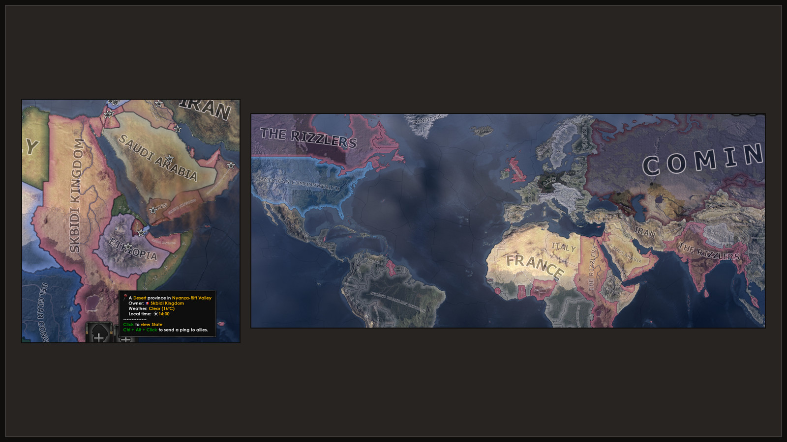

<!--
  Source: plugin/capie/REPO-README.md in the monorepo. tools/repo-split/split.ps1 publishes it
  as README.md at the root of the capie repository, so every relative path below is relative
  to that root, not to this folder. The technical notes on the native code are in
  plugin/capie/README.md.
-->

# CAPIE


**CAPIE (Cyprian's API Extender) is a small native library for Hearts of Iron IV.** It gives mods
a few things HOI4 script cannot do on its own: read what the player typed into the game's own
text field, show a custom name for a country or a faction, and show a chosen flag or leader
portrait. Mods use it through ordinary HOI4 script, and a mod written for CAPIE still loads and
runs when CAPIE is missing.

The first mod built on it is [Rename Anything](https://github.com/capie-mods/rename-anything).


> **Beta, nothing released yet.** There is no download, no Workshop item and no GitHub release.
> Everything described as working was checked in the game on HOI4 1.19.3.0, in single player, on
> development builds. Multiplayer has never been tested with two players, and we make no claim
> that it works.

## What it is

Two Windows DLLs, `capie_core.dll` and `capie_editor.dll`, that run inside `hoi4.exe` while you
play. They hook a few functions of the running game with [MinHook](https://github.com/TsudaKageyu/minhook),
answer some of the game's text and picture lookups, and add data to the commands the player
issues. CAPIE never writes to the game's files, and it never writes game state either: every
name, flag and portrait a mod sets lives in ordinary game variables, saved with the campaign.

CAPIE is not a game patch, not a general scripting engine and not a network client. Mods can
use only the operations CAPIE defines, and CAPIE checks every input.

## For modders

The contract is [`plugin/capie/CONTRACT.md`](plugin/capie/CONTRACT.md). It is plain HOI4 script:
you name your editor GUI by a fixed grammar, CAPIE adds the typed text to your Apply command as
temporary variables, and your effect reads them. Without CAPIE the same script takes the other
branch of your `if`. Scripts check `temp_var:capie_cap`, the API level, and compare it with `>=`.

| API level | CAPIE | What it adds | Checked in the game |
|---|---|---|---|
| 1 | 1.0 | Text fields for Rename Anything's own editors only | Yes |
| 2 | 1.1 | Text fields for any mod: up to 4 fields per editor, status keys `CAPIE_STATUS`, `CAPIE_API`, `CAPIE_BUILD` | Yes, with the SDK's demo mod |
| 3 | 1.1 | Console commands: `change_nation_name`, `reset_nation_name`, and `capie_cmd` for your own scripted effects ([console contract](plugin/capie/CONTRACT-console.md)) | Developer builds only |
| 4 | 1.2 | Country name layer: a custom name and adjective, with flag and colour left as they are | Yes: save, restart and load |
| 5 | 1.3 | Faction name layer, and the displayed name sent with the editor's opening | Once, on a 1.4 developer build |
| 6 | 1.4 | Country flag layer: any flag the game has, with the name kept | Once, on a 1.4 developer build |
| 7 | 1.5 | Leader portrait layer: the civilian portrait of a country's ruling leader | Not yet; offline tests only |

The name, flag and portrait layers are separate from cosmetic tags, so changing one leaves the
others alone. A portrait from a DLC the player does not own falls back to the game's portrait.




If you would rather not write the records yourself, the
[CAPIE Script SDK](https://github.com/capie-mods/capie-script-sdk) wraps the contract in ready-made
scripted effects for reading, checking and storing text, and comes with a small demo mod. It will
be its own Workshop item.

## For players

You only need CAPIE if a mod you play asks for it. The first release will install it in one of two
ways:

- one PowerShell line (`irm ... | iex`) with a small terminal interface, or
- an installer from GitHub Releases.

Both are in preparation. Until the first release the installer refuses to run on purpose; its
options are in [tools/bootstrap/README.md](tools/bootstrap/README.md).

Once installed, CAPIE loads only while the small "CAPIE" mod is enabled in your playset. Disable
it and the game starts clean. The installer can also switch CAPIE off, roll back an update and
uninstall it.

## Status

CAPIE supports one game build: HOI4 1.19.3.0 on Windows, from Steam. On any other build it stays
off and mods fall back to plain script. Developer builds of CAPIE 1.2 to 1.5 exist; nothing is
published.

Multiplayer is not tested. The contract describes a version check that keeps CAPIE features off
until every player has the same build, but that check has not run on two machines yet.

Achievements are not possible, because mods that change `common/` change the game's checksum.
Ironman was not tested.

The [status page of the CAPIE site](sites/capie/docs/status.md) lists what works and what is
still open.

## Safety



- **Fails closed.** CAPIE checks the SHA-256 of `hoi4.exe` and every byte pattern it hooks. If
  anything differs, it hooks nothing and the game runs without it. Bad input (empty, too long,
  characters the game cannot show) is rejected and nothing changes.
- **No network in the DLLs.** Current builds import only `KERNEL32` and `bcrypt`. The launcher and
  the proxy have no network code either. Only the installer goes online, and only when you ask it
  to install or update.
- **Game files stay unchanged.** The default launcher adds nothing to the game folder. The
  optional proxy loader adds one `version.dll` beside `hoi4.exe`, never replaces a `version.dll`
  it did not install, and its uninstall removes only its own file after checking the hash.
- **Scanned before release.** Every published binary will be scanned on VirusTotal, with the
  links in the release notes.

CAPIE loads itself into the game process, which some malware also does, so an antivirus may warn
about it. The source is here and you can build it yourself.

## How it starts


The launcher goes through the Paradox Launcher, so you keep your playsets. It waits for the main
menu, then loads `capie_core.dll` and `capie_editor.dll` into the `hoi4.exe` it started, and only
when the "CAPIE" mod is enabled. The proxy loader is the alternative for setups where a launch
option does not fit: it loads CAPIE when the game's command line contains `-capie`.

More detail: [architecture](docs/contributing/architecture.md),
[proxy loader](docs/contributing/proxy-loader.md), and the
[technical notes on the native code](plugin/capie/README.md).

## Building and testing

You need Windows 10 or 11, Visual Studio 2022 with the C++ x64 tools and a Windows SDK, a local
checkout of MinHook, [uv](https://docs.astral.sh/uv/) for Python, and HOI4 1.19.3.0 on disk for
the pin checks.

```powershell
.\plugin\capie\build.ps1 -MinHookDir 'C:\path\to\minhook'   # both flavors, offline tests, benchmarks
.\plugin\capie\mutation_check.ps1                           # mutation tests
pwsh -File .\plugin\capie\build_launcher.ps1                # launcher and its tests
uv sync; uv run ruff check; uv run pytest                   # Python tools and checks
```

No build or test starts the game or touches a running process; `hoi4.exe` is read only as a file
for the signature checks. The full guide is [building and testing](docs/contributing/building-and-testing.md),
and the documentation index is [docs/README.md](docs/README.md).

### Layout

`plugin/capie/` is CAPIE: the DLLs, the launcher, the proxy, the "CAPIE" switch mod and the
contract. `tools/bootstrap/` is the installer, `tools/release/` the release script,
`sites/capie/` the documentation site, and `docs/` the contributor guides and decision records.

## Related repositories

| Repository | What is in it |
|---|---|
| [rename-anything](https://github.com/capie-mods/rename-anything) | The mod for players: rename your country, its leader, parties, states and cities in the panel that shows the name. |
| [capie-script-sdk](https://github.com/capie-mods/capie-script-sdk) | Plain HOI4 script that lets any mod use CAPIE text fields without native code. |
| [capie-design](https://github.com/capie-mods/capie-design) | The design system both products share: colours sampled from the game, marks, diagrams and the docs theme. |

## License

The intended license is MIT. It is not in place yet: until a `LICENSE` file is added, all rights
are reserved.

## Credits

CAPIE uses [MinHook](https://github.com/TsudaKageyu/minhook) by Tsuda Kageyu, under the BSD
2-Clause license; see [plugin/LICENSE.MinHook.txt](plugin/LICENSE.MinHook.txt).

Hearts of Iron IV is a trademark of Paradox Interactive. This project is not affiliated with or
endorsed by Paradox Interactive.
