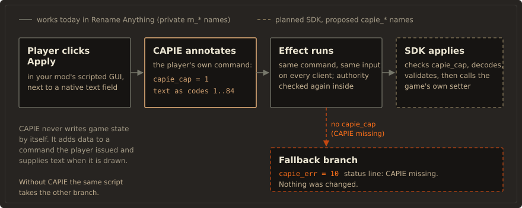

# Architecture

CAPIE has four layers. Each one depends only on the layer below it, and the bottom layer, the
game itself, is never modified.

<figure class="diagram" markdown="span">
  
  <figcaption>Mods call CAPIE through script; CAPIE works inside the running game.</figcaption>
</figure>

```text
 Dependent mods (Rename Anything, others)
   call SDK effects and triggers, ship the indicator snippet
 CAPIE script SDK (plain HOI4 script, versioned file names)        planned
   capie_v1_* triggers, effects, scripted loc, loc keys
   fallback branches, authority checks, cooldowns, validation
 CAPIE modules (native)
   text transport | names (RN1 cosmetic tag) | UI refresh
   status loc keys | version record for multiplayer (planned)
 CAPIE core (native)
   game build check (SHA-256) | signature table | hook manager
   input validation | capability and version registry | logging
 Unmodified HOI4 (hoi4.exe and steam_api64.dll untouched)
```

## Core

The core decides whether CAPIE may run at all.

- Game build check. CAPIE computes the SHA-256 of the running `hoi4.exe` with Windows `bcrypt`
  and compares it with the pinned build. <span class="st st-today">Works today</span>
- Pattern check. Every place CAPIE hooks must match a byte pattern exactly once, at the expected
  address, before any hook is switched on. <span class="st st-today">Works today</span>
- Hook manager. CAPIE uses MinHook. It enables all hooks or none, and it keeps trampolines until
  the process exits, because a call may still be running through one.
  <span class="st st-today">Works today</span>
- Signature table. One signed table per supported game build instead of constants in several
  source files. <span class="st st-planned">Planned</span>
- Capability registry. One API level plus a bit for each module that started.
  <span class="st st-planned">Planned</span> Today the country module exports a single capability
  value that is non-zero only after a successful start.

This is the pattern check from today's country module, unchanged:

```cpp title="plugin/src/country.cpp"
struct HookSpec { size_t rva; std::vector<int> pattern; void* replacement; void** original; };

bool unique_signature(const unsigned char* base, const IMAGE_SECTION_HEADER* text,
                      const HookSpec& hook) {
    const auto* start = base + text->VirtualAddress;
    const size_t size = text->Misc.VirtualSize;
    size_t matches = 0;
    for (size_t off = 0; off + hook.pattern.size() <= size; ++off) {
        bool match = true;
        for (size_t i = 0; i < hook.pattern.size(); ++i) {
            if (hook.pattern[i] >= 0 && start[off+i] != hook.pattern[i]) { match = false; break; }
        }
        if (match) {
            if (static_cast<size_t>(text->VirtualAddress) + off != hook.rva || ++matches > 1) return false;
        }
    }
    return matches == 1;
}
```

A pattern entry of `-1` is a wildcard for bytes that change when the game is relinked, such as
relative addresses. A second match anywhere in the code section, or a match at the wrong
address, fails the check.

<figure class="diagram" markdown="span">
  
  <figcaption>Start-up is all or nothing.</figcaption>
</figure>

Start-up errors are numbered, so a log line tells you which check stopped CAPIE:

| Code | Meaning |
|---|---|
| 0 | Active |
| 10 | Unsupported `hoi4.exe` hash |
| 11 | Wrong executable format or machine type |
| 12 | Code section not found |
| 20 | A pattern did not match exactly once at its address |
| 30, 31, 32 | MinHook could not initialise, create or enable the hooks |

## Modules

| Module | What it does | State |
|---|---|---|
| Names | Supplies a country's name and adjective from an `RN1\|Name\|Adjective\|` cosmetic tag when the game looks them up (three localisation lookups) | <span class="st st-today">Works today</span> |
| Status loc keys | Overrides reserved localisation keys when they are drawn; proven with `RN_PLUGIN_STATUS` | <span class="st st-today">Works today</span> for the mechanism; `CAPIE_*` keys <span class="st st-planned">Planned</span> |
| Text transport | Copies the text of a known native text field into temporary records of the player's own Apply command | <span class="st st-today">Works today</span> for Rename Anything's fields; other mods <span class="st st-planned">Planned</span> |
| Capability records | Adds the API level to known commands and removes script-set copies | <span class="st st-today">Works today</span> as `rn_native_cap`; `capie_cap` <span class="st st-planned">Planned</span> |
| UI refresh | Redraws a name in the open panel after a successful rename | <span class="st st-progress">In progress</span> |
| Version record | Adds the CAPIE version (`capie_ver`) to every annotated command, for the multiplayer check | <span class="st st-planned">Planned</span> |

Modules are compiled into one DLL, not loaded at run time, so the launcher's hash of that DLL
covers all native code.

## One rename, end to end

<figure class="diagram" markdown="span">
  
  <figcaption>Variant B: CAPIE adds data to a command; script decides what happens.</figcaption>
</figure>

1. The player opens an editor and types into the game's own text field (`editBoxType`).
2. On Apply or Enter, the game builds the scripted GUI command. CAPIE copies the field's text into
   temporary records of that command, as character codes, and adds the capability record.
3. The game runs the command's effect. The script checks the capability record, checks authority,
   decodes and validates the text, then calls a vanilla setter. For a country it sets a cosmetic
   tag of the form `RN1|Name|Adjective|`.
4. When the game draws the country's name, it looks up the localisation for that cosmetic tag.
   CAPIE answers that lookup with the stored name. Without CAPIE the lookup falls through to the
   game, which shows the original name.

## Principles

- Minimal intrusion: hooks only where a script cannot do the job, each forwarding to the original
  exactly once.
- Fail closed: an unknown build, an ambiguous pattern, bad input or a missing capability means
  CAPIE does nothing and the script takes its fallback branch.
- Full passthrough: anything CAPIE does not recognise exactly goes to the game unchanged.
- No network, no files: CAPIE opens no sockets and does no file input or output on behalf of
  scripts.
- Script is the source of truth: names live in the save through vanilla mechanisms. CAPIE keeps
  no sidecar files and no state between sessions.
- Visible degradation: when CAPIE is missing or too old, the player sees it.
