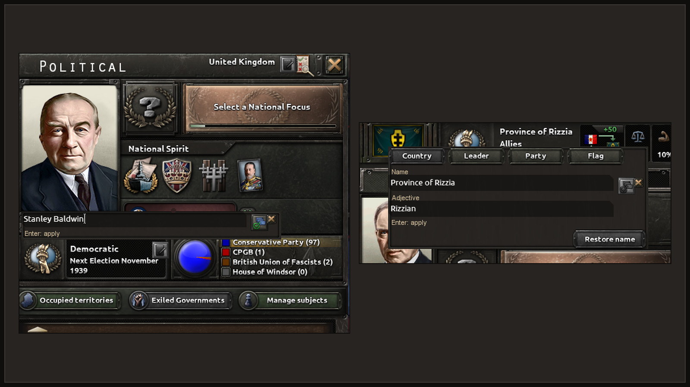
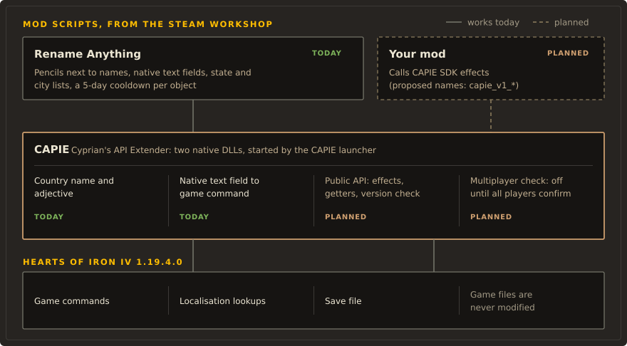

# CAPIE

CAPIE (Cyprian's API Extender) is a small native library for Hearts of Iron IV. It gives mods
a few abilities that the game's script language does not have, such as free text names for
countries and reading what the player typed into a text field.

!!! warning "Pre-release"

    Nothing is published yet. There is no download, no Workshop item and no release. The parts
    marked Works today were checked in the game on development
    builds, in single player, on HOI4 1.19.3.0. Everything else on this site is a plan, and the
    pages say so.

## What CAPIE is

CAPIE is two Windows DLLs that run inside the game process while you play. It does not change
any file of the game. It hooks a few places in the running `hoi4.exe`, supplies text when the
game looks it up, and adds data to game commands that the player issues. Mods talk to it through
ordinary HOI4 script.

Rename Anything is the first mod built on CAPIE. It lets you rename your country, its leader and
its parties in the panel where the name is shown, and your subjects through diplomacy. Your country's name and adjective need CAPIE,
because the game has no script effect that takes free text for a country. The in-panel text
fields need it too: a script cannot read what the player typed, so CAPIE passes the text to the
mod inside a game command.

<figure class="diagram" markdown="span">
  
  <figcaption>Two Rename Anything editors on CAPIE: the game's own text field, opened next to the name it changes.</figcaption>
</figure>

<figure class="diagram" markdown="span">
  
  <figcaption>Mods call CAPIE through script. CAPIE talks to the running game. Game files stay as they are.</figcaption>
</figure>

## What CAPIE is not

- It is not a game patch. It never writes to the game folder, `hoi4.exe` or `steam_api64.dll`.
- It is not a network client. Current builds import only `KERNEL32` and `bcrypt`.
- It is not a general scripting engine or a way to run arbitrary code from a mod. Mods can use
  only the operations CAPIE defines, and CAPIE checks every input.
- It is not anti-cheat and not a multiplayer server. In multiplayer it can only refuse to switch
  its own features on (see [Multiplayer](multiplayer.md)).
- It does not change cosmetic tags. A custom country name and a chosen flag are layers of their
  own, so renaming keeps the flag and choosing a flag keeps the name (see
  [Name layers](modders/name-layers.md)).
- It is not needed for names a mod knows in advance. Vanilla `set_cosmetic_tag`,
  `set_party_name` and `set_character_name` already handle those.

## Where to go next

| If you are | Read |
|---|---|
| A player who wants to know if CAPIE is safe | [Safety](safety.md), then [Install](install.md) |
| A modder who wants to use CAPIE | [For modders](modders/index.md) and the [script contract](modders/contract.md) |
| Curious how it works inside | [Architecture](architecture.md) |
| Looking for what actually works | [Status](status.md) |

!!! note "File names"

    The DLLs and the injector are called `capie_core.dll`, `capie_editor.dll` and
    `capie_injector.exe`. The launcher (`RenameAnythingLauncher.exe`) and the install folder
    (`%LOCALAPPDATA%\RenameAnything`) still carry the name from before the naming decision.
