# Install

!!! warning "Available with the first release"

    There is no release yet, so nothing on this page can be installed today. The installer
    script exists and has offline tests, but its release address, pinned package hash and
    signing key are placeholders, and it refuses to install on purpose. The proxy and launcher
    modes have development builds. This page describes the intended release installation.

## How it will work <span class="st st-progress">In progress</span> { #plan }

1. Subscribe to the mods you want (for example Rename Anything) and to the small **CAPIE** mod on
   the Steam Workshop, and add them to a playset in the Paradox Launcher.
2. Install CAPIE once, in one of two ways:
    - one line in PowerShell (`irm ... | iex`), which runs the installer with a terminal
      interface;
    - the installer from the project's GitHub Releases page.
3. Press Play as usual. CAPIE loads only while the CAPIE mod is enabled in the active playset.
   Disable that mod and the next start is the plain game, as if CAPIE were not installed.
4. To remove CAPIE completely, run the installer's uninstall command. It puts back what it changed.

The Paradox Launcher cannot get an extra button, which is why the switch is a mod. The CAPIE mod
contains no game content; the CAPIE launcher reads the playset the Paradox Launcher writes and
decides from it. If that file cannot be read, the game starts without CAPIE and a short notice
says so.

The rest of this page describes the installer script as it exists in development. Its default
today is the proxy loader; the launcher with the playset switch above is the method chosen for
release, and the proxy stays available as the alternative.

You need Windows, Hearts of Iron IV 1.19.3.0 from Steam, and Windows PowerShell 5.1 (built into
Windows) or PowerShell 7. Proxy installation needs write access to the game directory.
The launcher alternative keeps its files in your local application data.

## How the game will start

The default `-LoadMethod Proxy` adds one `version.dll` beside `hoi4.exe`. It forwards the
system version APIs and loads the verified CAPIE runtime only when explicitly enabled.
Steam and the Paradox Launcher can keep their normal launch chain.

Flag activation (`-ProxyActivation Flag`, default) uses the exact `-capie` argument. Actual
Steam/Paradox forwarding still needs an end-to-end check. The explicit fallback
`-ProxyActivation Config` writes `proxy.enabled` under `%LOCALAPPDATA%\RenameAnything`;
it stays enabled until the marker is removed or CAPIE is uninstalled. Removing a Steam flag
does not disable config activation. A foreign `version.dll` is a conflict and is left intact.

Use `-LoadMethod Launcher` for the existing wrapper alternative, described below.

<figure class="diagram" markdown="span">
  
  <figcaption>Launcher alternative. Steam/Paradox end-to-end acceptance remains pending.</figcaption>
</figure>

## Install with one line

Recommended: download the script, read it, then run it.

```powershell title="Download, check, run"
# 1. Download. OWNER and TAG are filled in with the first release.
Invoke-WebRequest https://raw.githubusercontent.com/OWNER/hoi4-rename-anything/TAG/tools/bootstrap/install.ps1 -OutFile install.ps1
# 2. Read it (notepad install.ps1) and compare its SHA256 with the release notes.
Get-FileHash .\install.ps1
# 3. Run it. It asks before it changes anything.
powershell -ExecutionPolicy Bypass -File .\install.ps1
```

The one-liner does the same in a single step:

```powershell title="One line (convenient, less safe)"
irm https://raw.githubusercontent.com/OWNER/hoi4-rename-anything/TAG/tools/bootstrap/install.ps1 | iex
```

!!! warning "What `irm | iex` means"

    Whatever the address serves at that moment runs right away with your user rights. You do not
    see it first and nothing checks its hash. Everything the script downloads afterwards is
    verified, but nothing can verify the script that `iex` runs. Downloading and reading it
    first is the real protection.

The script asks:

1. Whether to install the verified CAPIE bundle into `%LOCALAPPDATA%\RenameAnything\<version>`.
2. Proxy loading (default) or the launcher alternative, then the matching Steam/shortcut integration.
3. For Steam and shortcuts, a warning that the game with CAPIE is not declared multiplayer
   compatible, and a confirmation.
4. Where to put the shortcut: Desktop by default, or a folder you pick.
5. Which Steam accounts to change, if there are several.

The install folder and shortcut name still carry the Rename Anything name from before the naming
decision. They will change with the planned rename to CAPIE.

## Steam launch option: launcher alternative

With this option, pressing Play in Steam starts the game with CAPIE. The script adds the
launcher in front of `%command%` in the game's launch options and keeps everything else you had
there:

| Before | After |
|---|---|
| (empty) | `"…\RenameAnything\current\RenameAnythingLauncher.exe" %command%` |
| `-debug_mode` | `"…\RenameAnythingLauncher.exe" %command% -debug_mode` |
| `"C:\other.exe" %command% -x` | `"C:\other.exe" "…\RenameAnythingLauncher.exe" %command% -x` (with a warning) |

Steam must be closed while the script edits its settings file (`localconfig.vdf`). The script
waits for you to close it and never closes Steam itself. It makes a byte-exact backup first,
checks the result, and restores the backup on any difference.

To undo it by hand: Steam, Library, Hearts of Iron IV, Properties, General, Launch Options.
Delete the quoted `…\RenameAnythingLauncher.exe` part.

## Shortcut

The script can also create a shortcut that starts the same chain: the CAPIE launcher with the
game's Paradox Launcher (`dowser.exe`) as its argument, which is what Steam's `%command%` points
to. Its icon comes from `hoi4.exe`, and its comment says that it starts the game with CAPIE and
that this setup is not declared multiplayer compatible. The script never overwrites a file it did
not create.

Passing switches works without questions:

```powershell
& ([scriptblock]::Create((irm https://raw.githubusercontent.com/OWNER/hoi4-rename-anything/TAG/tools/bootstrap/install.ps1))) -Install -Shortcut -Yes
```

## Updates, only when you ask

CAPIE and the launcher never check for updates in the background.

```powershell
.\install.ps1 -CheckUpdate   # one request: newest version, and whether it supports your hoi4.exe
.\install.ps1 -Update        # install the newest signed release and switch to it
.\install.ps1 -Rollback      # switch back to the previous version, kept on disk
```

`-Update` accepts a release only if its manifest is signed with the key pinned in the script,
its tag matches the manifest, and every downloaded file matches the SHA-256 in the manifest.
Steam and shortcuts always point at a `current` folder link, so an update never touches Steam
again.

## Before multiplayer

While CAPIE is in your launch options, your game is not declared multiplayer compatible. Remove
the launch option before you play multiplayer:

```powershell
.\install.ps1 -RemoveSteamLaunchOption
```

## Uninstall

```powershell
.\install.ps1 -Uninstall
```

This removes the launch option part, the shortcuts the script created, and
`%LOCALAPPDATA%\RenameAnything` (the log file stays). Nothing in the game folder needs repairing.
Add `-DryRun` to any command to see what it would do without writing anything.

Names you set with a mod built on CAPIE stay in your saves. Without CAPIE, a custom country name
is expected to show as the original name. That has been seen with CAPIE not loaded and the mod
enabled; loading such a save with the mod disabled entirely has not been tested yet, so try it on
a copy.

## Today: development builds

Testers who are comfortable with a developer setup can load CAPIE by hand. The steps are in the
repository's `plugin/capie/README.md`: build the DLLs and run the injector against the running
game.
This must be repeated every time the game starts. It is a development path, not the way players
are meant to install CAPIE.
