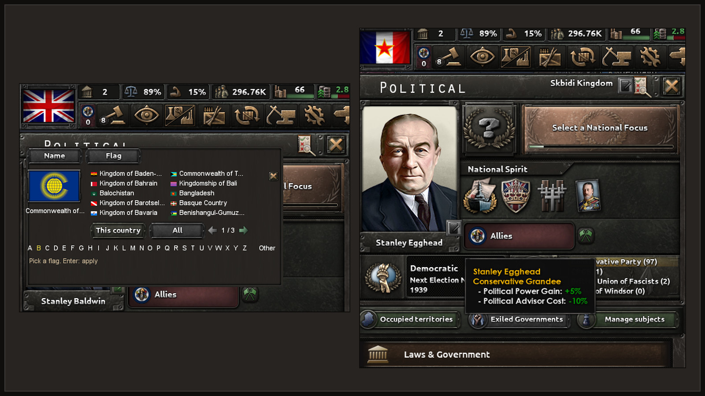

# Name and flag layers

A name a player or a mod gives a country is its own layer, kept in ordinary country variables.
It is not a cosmetic tag, so the country keeps its flag and colour. CAPIE draws the layer when the
game asks for the country's name.

| Layer | API level | State |
|---|---|---|
| Country name and adjective | 4 (CAPIE 1.2) | <span class="st st-today">Works today</span> on a developer build: own country, a subject, reset from the console, save, restart and load |
| Faction name | 5 (CAPIE 1.3) | <span class="st st-today">Works today</span> on a CAPIE 1.4 developer build: name with Polish letters and its reset |
| Country flag | 6 (CAPIE 1.4) | <span class="st st-today">Works today</span> on a developer build: own flag, a subject taking the overlord's flag, reset |

Nothing is released yet. The full text is in sections 14 and 15 of `plugin/capie/CONTRACT.md` in
the repository.

## What the player sees

For a country, the game shows the first of these that exists:

1. the name layer, when it is set and valid;
2. the country's current cosmetic tag;
3. the base name of the tag.

Removing the layer shows the current cosmetic tag again, not the base name. When the game or
another mod changes the cosmetic tag later, the layer keeps showing.

<figure class="diagram" markdown="span">
  
  <figcaption>A country name layer on the map (left) and a faction name layer in the faction map mode (right), set through Rename Anything.</figcaption>
</figure>

!!! note "Open decision"

    Whether a cosmetic tag change should also clear a custom name is not settled. Today it does
    not. Write your mod so that it works either way.

## Country name layer (API level 4) { #country }

Four variables on the country that has the name:

| Variable | Value |
|---|---|
| `capie_cn_n` | array of the name's character codes, 1 to 32 elements ([alphabet](contract.md#alphabet)) |
| `capie_cn_a` | array of the adjective's character codes, 1 to 32 elements |
| `capie_cn_ver` | `1` while the layer is set; absent means no layer |
| `capie_cn_rev` | set by every change, as the last statement; the value is not used |

They are written only by script, saved with the game, and synchronised in multiplayer like any
other variable.

```paradox title="Set and remove the layer (scope: the country)"
clear_array = capie_cn_n
clear_array = capie_cn_a
add_to_array = { capie_cn_n = 40 }   # one per character of the name
add_to_array = { capie_cn_a = 14 }   # one per character of the adjective
set_variable = { capie_cn_ver = 1 }
set_variable = { capie_cn_rev = 1 }  # last: CAPIE refreshes the names now

# Remove it:
clear_array = capie_cn_n
clear_array = capie_cn_a
clear_variable = capie_cn_ver
set_variable = { capie_cn_rev = 1 }
```

You rarely write these by hand. The SDK's `capie_v1_set_country_name` writes the layer from text
slots 1 and 2 of ROOT, and `capie_v1_clear_country_name` removes it
([Text tools](text-tools.md#setters)). Use `set_variable`, not `add_to_variable`, for
`capie_cn_rev`, without a scope prefix, in the scope of the country.

### What CAPIE does with it

While the game rebuilds a country's cached name, adjective and definite name, `capie_core.dll`
puts a valid layer in place of the tag the names are built from. After every `set_variable` of
`capie_cn_rev` it rebuilds the names of every country whose layer changed. The game also rebuilds
names on load and whenever the cosmetic tag, the ideology, the popularities or a subject relation
change, and the layer applies there too. CAPIE writes no variable, no cosmetic tag and no country
field.

A layer is treated as absent when `capie_cn_ver` is not exactly 1, a count is outside 1 to 32,
an element is missing, not whole or outside 1 to 264, or the text fails CAPIE's input checks.

If the game code CAPIE hooks for the layer does not match after a patch, the layer switches off
on its own while the rest of CAPIE keeps working, and `capie_core.log` says so.

Not covered: `GetNonIdeologyName*`, the non-ideology parameters of subject name formats, the
tooltip of `set_cosmetic_tag`, and localisation that names a tag key directly, such as `$CAN$`.
These show the game's name.

### Older saves

Countries renamed with CAPIE 1.0 or 1.1 carry their name as an `RN1|Name|Adjective|` cosmetic
tag. CAPIE still draws it. Rename Anything drops that cosmetic tag once, on the first Apply or
reset of the country. The cosmetic tag that `RN1|` replaced was never stored, so it cannot come
back.

## Faction name layer (API level 5) { #faction }

The same idea for factions, stored on the faction leader:

| Variable | Value |
|---|---|
| `capie_fn_n` | array of the name's character codes, 1 to 32 elements |
| `capie_fn_ver` | `1` while the layer is set |
| `capie_fn_rev` | set last by every change |

When the leader of a faction has a valid layer, the faction views, diplomacy and
`[GetFactionName]` show it. The name the game stores in the faction never changes, so removing
the layer shows it again. When the faction gets another leader, the layer stays with the old
leader and the faction shows the game's name.

The SDK has no faction setter yet; write the variables as shown for countries, with one array.

## Country flag layer (API level 6) { #flag }

A flag chosen for a country is a layer too. The cosmetic tag is not touched, so the name and the
map colour stay the game's. The layer names one flag file of the game by its stem (the file name
without `.tga`, for example `POL_KINGDOM_neutrality`); the game loads that file for all three flag
sizes. A missing file shows the game's flag.

| Variable | Value |
|---|---|
| `capie_cf_ver` | `1` while the layer is set |
| `capie_cf_len` | number of characters of the stem, 1 to 63 |
| `capie_cf_s` | the stem, three characters per array element, in the file-name alphabet `a-z A-Z 0-9 _` |
| `capie_cf_cos_len`, `capie_cf_cos` | the cosmetic tag the country had when the flag was chosen |
| `capie_cf_rev` | set last by every change |

Unlike the name, the flag ends when the cosmetic tag changes: CAPIE stops showing it at once, and
the mod's daily check removes the variables. A subject that takes its overlord's flag stores a
copy of the overlord's flag at that moment; it does not follow later changes. The packing of the
stem, the reset rules and the exact effect blocks are in section 17 of `plugin/capie/CONTRACT.md`.

<figure class="diagram" markdown="span">
  
  <figcaption>The country flag layer (API level 6, CAPIE 1.4 developer build): any flag of the game, chosen in Rename Anything, without changing the name or colour.</figcaption>
</figure>

## Without CAPIE and in multiplayer

The variables stay in the save. Without CAPIE the game shows the cosmetic tag or base name, with
the right flag, and the faction shows its stored name. Because the layer is game state written by
effects, every client holds the same variables; CAPIE only changes what is drawn. A client
without CAPIE simply sees the game's names. Multiplayer has not been tested; see
[Multiplayer](../multiplayer.md).
