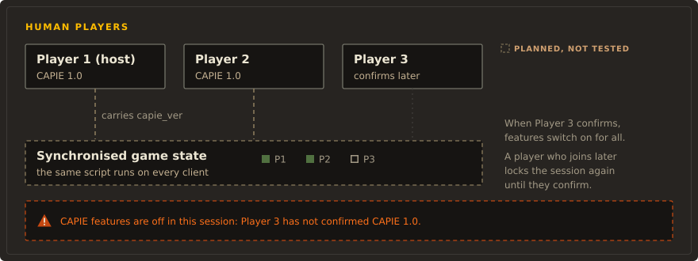

# Multiplayer

!!! warning "Not supported"

    CAPIE has never been tested with two players. Do not use it in multiplayer. Remove the CAPIE
    launch option before you join or host a multiplayer game
    (`install.ps1 -RemoveSteamLaunchOption`, or by hand in Steam).

Two game instances cannot run on one desktop: the game checks for an existing window at start-up
and exits. A real test needs a second machine, and that test has not happened yet.

## What is known

From reading the game's code and from single-player runs:

- When a player clicks a scripted GUI button, the game writes the command into a byte stream
  and creates a fresh copy from it before running it. In single player the records CAPIE adds
  to a command survived that round trip intact. A network game sends the same byte stream, so
  every client should receive the same records whether or not it runs CAPIE. That is a strong
  expectation, not a two-machine result.
- The game runs a command's effect without checking who sent it and without repeating the
  button's `visible` and `enabled` triggers. Every rule about who may do what must be checked
  inside the effect itself. See [Permissions](permissions.md).
- Each client draws country names from its own CAPIE. A client without CAPIE sees the original
  name. The cosmetic tag itself is ordinary synchronised game state. If any game code stored a
  drawn name into game state, clients could diverge; no such code was found, but it was not
  ruled out either. So all players need the same CAPIE version.
- CAPIE must never change game state on one machine outside a command to "fix" a mismatch. That
  would itself cause an out-of-sync game.

## The plan: a version check in script <span class="st st-planned">Planned</span> { #version-check }

CAPIE does not kick anyone and does not touch the network. Instead, every CAPIE feature stays off
for everyone until every human player has shown the same CAPIE version, and a banner says so.

<figure class="diagram" markdown="span">
  
  <figcaption>Lock and banner. Deterministic script on synchronised state.</figcaption>
</figure>

1. Every command CAPIE annotates carries one more record, the CAPIE version as a small number
   (`capie_ver`), next to the capability record.
2. The command's effect runs on every client and stores that number on the issuing player's
   country, for example `set_variable = { capie_ver_seen = temp_var:capie_ver }`.
3. The script compares human countries (`is_ai = no`). While any of them has no stored version,
   or a different one, CAPIE features stay off for everyone and a banner names who is missing,
   for example: "CAPIE features are off in this session: Player 3 has not confirmed CAPIE 1.0."
4. A player without CAPIE sends no version at all, which the script sees as a missing value.

<span class="proposed-tag">Proposed, subject to change</span>

```paradox
# PROPOSED. Runs first in every CAPIE-annotated command.
if = {
	limit = { check_variable = { temp_var:capie_ver > 0 } }
	set_variable = { capie_ver_seen = temp_var:capie_ver }
}

# PROPOSED. A scripted trigger: true while some human country is missing or different.
capie_v1_mp_mismatch = {
	any_country = {
		is_ai = no
		NOT = { check_variable = { capie_ver_seen = global.capie_ver_expected } }
	}
}
```

Limits of this design:

- A player is detected only after they issued at least one CAPIE command, so each player first
  needs a small "CAPIE check" button or an editor action. An automatic check without a click
  would require CAPIE to send a command on its own, which is a new and riskier path that is not
  planned without a separate review.
- A player who joins later controls a human country without a stored version, so the session
  locks again until they confirm. A player who leaves hands the country back to the AI, which
  drops out of the check. Both behaviours are expected, not tested.
- It cannot refuse or kick a player. That would take code at the network level, which CAPIE
  does not have and will not add. The original request to reject players without CAPIE was
  replaced by this lock and banner.

## Host and overlord permissions

Who may rename what in multiplayer, including the host's lobby game rule and the overlord of a
player subject, is on the [Permissions](permissions.md) page.
